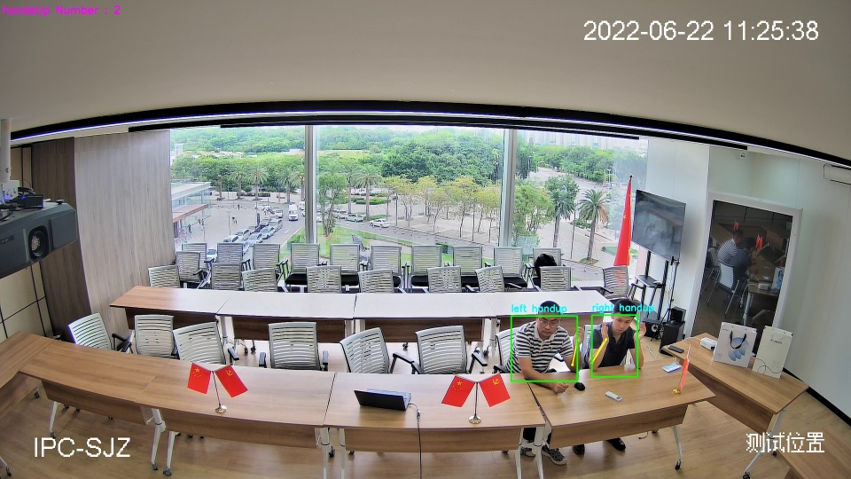
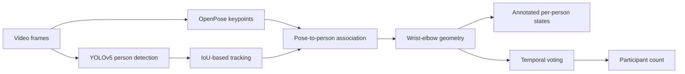
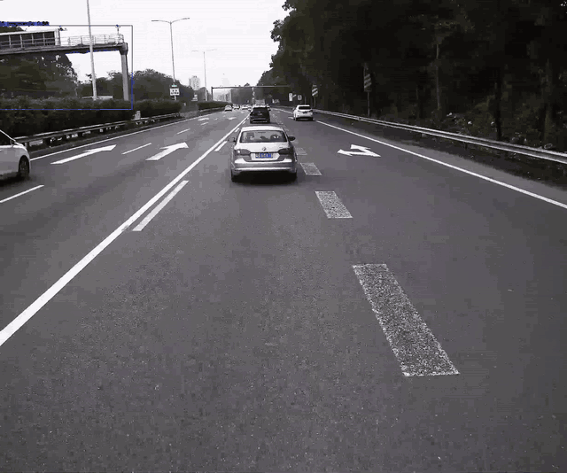
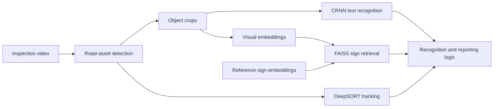
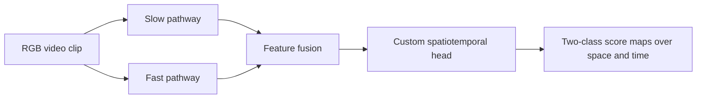

# Computer Vision Projects

**Jiaming Yue · Computer vision, video analysis, and industrial AI**

Three collaborative projects from my time at SmartMore, covering human activity analysis and road asset inspection. Each section below introduces the function, available demonstration, pipeline, and code. The project pages provide implementation details and describe my involvement.

| Project | Function | Available demonstration | Code type |
| --- | --- | --- | --- |
| [Hand-Raise Counter](hand-raise-counter/README.md) | Identify and count participants raising their hands | Historical annotated screenshot | C++ inference SDK; TensorRT integration |
| [Road Asset Inspector](road-asset-inspector/README.md) | Detect road assets, read text, retrieve signs, and associate observations across frames | Historical traffic-sign GIF | Python inference and application pipeline; CRNN, FAISS, DeepSORT |
| [Parcel Handling Monitor](parcel-handling-monitor/README.md) | Explore recognition of potentially rough handling from video | Spatiotemporal two-class score maps (model output) | Python / PyTorch training and evaluation code; custom SlowFast model |

## 1. Hand-Raise Counter

### Function

Identify participants raising their hands in a fixed-camera meeting-room video and aggregate their states into a participant count. Tracking and temporal voting help stabilize observations across frames.

### Demonstration



*Historical screenshot from the original SDK documentation. The display reports two participants raising their hands. This single frame illustrates the output format; it does not establish counting accuracy or temporal stability.*

### Pipeline



### Code

**C++ inference SDK** with TensorRT integration, pose post-processing, tracking, and temporal counting. Model weights and required company runtime dependencies are not included; the archived system has not been rerun for this portfolio.

[Project details](hand-raise-counter/README.md) · [Browse source](hand-raise-counter/source/)

## 2. Road Asset Inspector

### Function

Detect road assets in inspection video, recognize text with CRNN, retrieve similar traffic signs using visual embeddings and FAISS, and use tracking in repeated-processing and reporting logic. Traffic-sign retrieval is one module within the road-inspection system.

### Demonstration



*Eight-second excerpt from a historical project recording (10–18 s), resized to 640 pixels wide at 6 fps for inline display. This shows annotated traffic signs; it is not a new benchmark or evidence that every module below is demonstrated.*

### Pipeline



### Code

**Python inference and application code**, including recognition modules, tracking, configuration, and pipeline entry points. This is a selected source snapshot from the broader road project, not a complete training-and-deployment distribution with all models and dependencies.

[Project details](road-asset-inspector/README.md) · [Browse source](road-asset-inspector/source/) · [Integrated asset module](road-asset-inspector/source/SMore_road/module/asset.py)

## 3. Parcel Handling Monitor

### Function

Explore recognition of potentially rough parcel handling from RGB video clips. My participation was in the earlier SlowFast-based approach. The later pose-based system is described separately on the project page as technical context.

### Demonstration

The model produces two-class score maps over space and time, representing its predictions within the input clip. This describes the implemented output, rather than a measured detection result.

### Pipeline



### Code

**Python / PyTorch training and evaluation code** with a custom `SlowFastSeg` model, task-specific dataset loader, and configuration. The inspected setup uses a ResNet-50 backbone and 32-frame clips. A matching trained checkpoint and reproducible evaluation result have not been established. The code package contains the earlier SlowFast approach, not the later OpenPose + MLP SDK.

[Project details](parcel-handling-monitor/README.md) · [Browse source](parcel-handling-monitor/source/) · [Task configuration](parcel-handling-monitor/source/configs/ChinaPost/SLOWFAST_SEG_8x8_R50.yaml)

## Repository layout

```text
hand-raise-counter/           Project description and C++ SDK source
road-asset-inspector/  Project description and Python road pipeline
parcel-handling-monitor/        Project description and SlowFast source
assets/                Historical screenshot and road GIF
```

## Scope and attribution

These were team projects. The project pages distinguish my participation from the wider implementation. Historical source notices and third-party licenses are retained. No end-to-end reproduction or new performance evaluation is claimed.

This repository contains selected historical source snapshots and project demonstrations. Machine-specific data paths have been replaced with placeholders; model weights and private runtime dependencies are not included. No blanket license is assigned to the historical code; existing third-party notices are retained.

Related work: [video-based physiological sensing experiments](https://github.com/KKjiaming/video-based-physiological-sensing).
