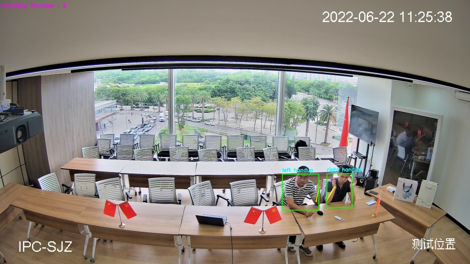
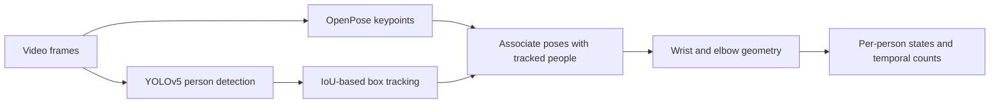

# Hand-Raise Counter

[Back to portfolio](../README.md)

## Historical example

An example image preserved in the original SDK documentation, dated June 22, 2022 in the camera overlay. The output shows two boxed participants, left/right hand-raising labels, and an on-screen count of two. This is a historical screenshot, not a newly reproduced result or an accuracy evaluation.

## Problem

Count participants raising their hands in a fixed-camera meeting-room video. A useful system needs to associate observations with people and avoid unstable counts caused by brief detection errors.

## My involvement

I contributed to a team project combining person detection, pose estimation, tracking, and hand-raising decisions. The description below covers the archived pipeline; it does not imply that I independently authored every component.

## Approach

1. **Detect and associate people.** YOLOv5 supplies person boxes and OpenPose supplies body keypoints. Box tracking uses overlap with a center-distance fallback. Poses are associated with tracked boxes through the nose keypoint.
2. **Recognize raised hands.** Rules examine wrist–elbow positions, forearm angles, and minimum distances. A participant raising both hands is counted as one person.
3. **Aggregate observations.** Temporal voting over each tracked person's observed states reduces brief fluctuations in the count.

The archived implementation uses a forearm angle above 50 degrees and requires at least six positive observations within a 15-observation window. These are historical settings, not general recommendations. An observation window is not necessarily a fixed number of consecutive video frames.

## Practical considerations

Occluded wrists, overlapping people, pose-to-box association, and tracking errors can affect counts. Pixel-based distance thresholds also depend on image scale. Static review found counting and temporal-window boundary issues that would need checking before a new release.

## Evidence and current status

The historical C++ SDK and an example image have been located and inspected. The active implementation uses TensorRT and an encrypted model container. Required models and company runtime dependencies are missing from the reviewed archive, so end-to-end inference has not been reproduced here.

No accuracy or speed measurement is claimed. The historical screenshot above is available; the corresponding video has not been located.

## Suggested demonstration

A useful video would show the input, person IDs, keypoints, individual raised-hand states, and the aggregate count. It should include both stable detections and examples of occlusion or tracking failure.
