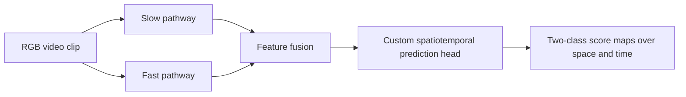

# Parcel Handling Monitor

[Back to portfolio](../README.md)

## Problem

Explore video-based recognition of potentially rough parcel handling. Appearance and motion provide useful evidence, but rapid movement alone does not establish parcel damage or inappropriate handling.

## My involvement

I worked with a colleague on the earlier SlowFast-based approach. A later pose-based implementation was also found in the project archives. It is included below as technical context, not claimed as my own development work.

## Earlier approach: SlowFast-based video modeling

The archived task configuration selects a custom `SlowFastSeg` model with a ResNet-50 backbone, 32-frame clips, and two output classes. The fast and slow pathways use different temporal sampling rates.

The inspected implementation retains spatial and temporal predictions instead of returning only a single clip-level label. The dataset loader builds dense targets from per-frame rectangle annotations; these are not precise body segmentation masks.

The source establishes the architecture and training setup, but does not by itself establish that a particular checkpoint was trained successfully or achieved a given result. No verified numerical benchmark is reported here.

## Later approach found in the archive

A separate C++ SDK uses an OpenPose-based pose frontend and per-person temporal decisions. It includes both arm-motion rules and an MLP classifier. The MLP input combines five observations of normalized joint offsets and confidence scores into a 65-dimensional vector. The deployment targets a HiSilicon camera platform.

| Aspect | Earlier SlowFast approach | Later pose-based SDK |
| --- | --- | --- |
| Model input | RGB video clips | Short sequences of joint features |
| Core representation | Learned appearance and motion features | Joint geometry, confidence, and temporal changes |
| Inspected model output | Two-class spatiotemporal score maps | Per-person action score or rule decision |
| Personal contribution presented here | Participation in the earlier approach | Archive review and technical context only |

These approaches address the same business problem, but their model inputs and outputs are different. They are not interchangeable implementations of one interface.

## Practical considerations

Normal handling can involve fast arm movement. Occlusion, small people in the frame, viewpoint changes, and ambiguous action boundaries make evaluation difficult. A useful evaluation needs both normal and rough-handling clips and should report missed detections alongside false alarms.

## Evidence and current status

The SlowFast training source and later pose SDK have been located and inspected. Neither has been rerun for this portfolio. A matched checkpoint, evaluation split, and public demonstration have not been established, so no accuracy or deployment-speed claims are made.
