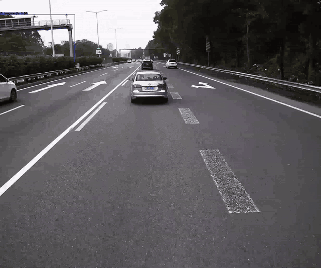
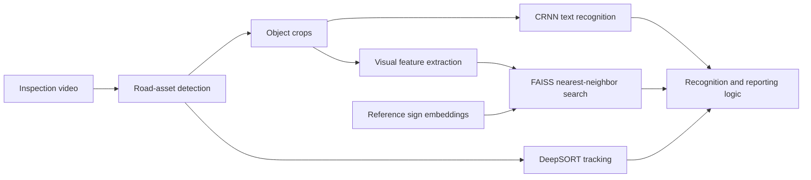

# Road Asset Inspector

[Back to portfolio](../README.md)

## Historical demonstration

This GIF shows an eight-second excerpt (10–18 s) from a historical recording, resized to 640 pixels wide at 6 fps. It is not a newly reproduced benchmark. It should not be taken as evidence that every pipeline module below is shown in the video.

## Problem

Recognize road assets from inspection video, retrieve traffic-sign candidates, and reduce repeated reports when the same asset appears in consecutive frames. Traffic-sign retrieval is one component of the wider road-inspection pipeline.

## My involvement

I contributed to the road-inspection system, including the integration of detection, CRNN text recognition, traffic-sign retrieval, and tracking. This is a team project; the pipeline description does not imply sole authorship of all components.

## Approach

### 1. Detection and recognition

The system detects relevant road assets and routes crops to the appropriate recognition component. CRNN is used for text recognition. Text recognition and visual retrieval serve different purposes: reading visible text versus matching a crop to reference sign images.

### 2. Traffic-sign retrieval

The reviewed retrieval module extracts 512-dimensional embeddings and queries a FAISS `IndexFlatL2` index. Its default setting returns three nearest candidates. The inspected configuration applies retrieval to triangular signs; this does not establish performance across every sign category.

### 3. Tracking and repeated reports

DeepSORT maintains identities across frames. Application logic uses tracked IDs to suppress repeated processing or reporting in selected branches. Tracking alone is not a guarantee that all duplicate records are removed.

## Practical considerations

Small or blurred crops can lose the details required for retrieval or OCR. Similar sign designs can produce ambiguous matches, while occlusion and tracking interruptions can affect repeat suppression. Evaluation should separate retrieval quality, OCR errors, and tracking/reporting errors.

## Evidence and current status

The road-inspection source has been reviewed, including retrieval and tracking integration. A historical traffic-sign video is included for demonstration. Model weights are not included; the source snapshot is not a complete runnable distribution.

This portfolio has not reproduced end-to-end inference or measured retrieval accuracy. A useful next demonstration would show a query crop, its ranked reference matches, and its identity across video frames.
